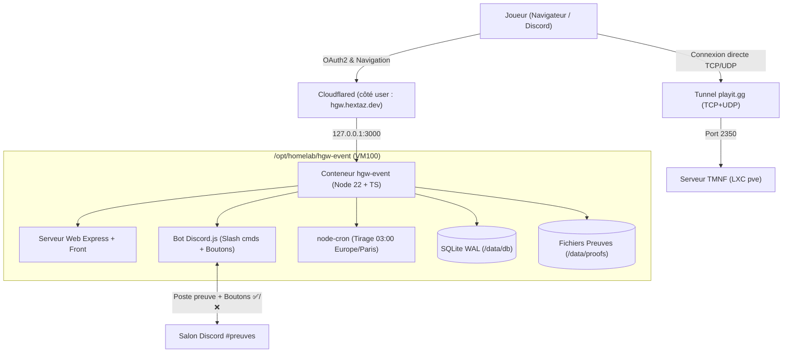

# Spécification V1.2 — Hextaz Games Week (HGW)

> **Document de cadrage complet (Site Event + Bot + Infra + Catalogue de Quêtes)**
> Nom officiel : **Hextaz Games Week (HGW)** — Sous-domaine cible : `hgw.hextaz.dev`

---

## 0. Résumé exécutif

Event communautaire Discord sur **1 semaine** : défis asynchrones toute la semaine (Trackmania permanent + défis quotidiens personnalisés sur une douzaine de jeux) et **events live le week-end** (tournois Brawlhalla, Rocket League Rumble, Fall Guys + Cup Trackmania live).

Un **site event dédié (`hgw.hextaz.dev`)** centralise profils Discord, inscriptions aux tournois, tirage d'équipes équilibrées par chapeaux (pools de niveau), défis quotidiens, preuves, classement et points — c'est la **seule source de vérité des points**. **TournamentHub** (existant, VM100) gère les arbres (brackets) des tournois live. Gains : carte cadeau 10€, Discord Nitro, sub Twitch + tombola.

---

## 1. Contexte & objectifs

- Communauté Discord (~8–24 joueurs).
- Objectifs : engagement sur toute la semaine (pas uniquement le week-end), variété multi-jeux, équipes équilibrées, récompenses accessibles et motivantes.
- L'event est conçu pour des personnes en emploi ou en études : **tout l'async est à rythme libre** (défis réalisables en 15–35 min), seuls les events live du week-end ont des créneaux fixes.

---

## 2. Décisions actées

| # | Décision |
|---|---|
| **D1** | **3 couches de défis** : permanent global (TMNF), quotidien personnalisé (reset 3h00), live week-end (tournois). Chaque source de points est taguée `async` ou `live`. |
| **D2** | **TournamentHub = gestionnaire de brackets uniquement**. L'inscription aux tournois et la répartition par **pools de niveau (Chapeaux 1 / 2 / 3)** pour équilibrer les équipes se font directement sur le site HGW. |
| **D3** | **Site HGW = app séparée**, seule source de vérité des points (`points_ledger`). |
| **D4** | Site hébergé sur **VM100** dans un compose dédié (`/opt/homelab/hgw-event`), bind **127.0.0.1:3000 uniquement**. L'exposition publique HTTP (`cloudflared` sur `hgw.hextaz.dev`) est opérée par l'utilisateur — l'assistant ne crée aucune exposition publique. |
| **D5** | **Un seul conteneur applicatif Node.js** (Express + Bot `discord.js` + `node-cron` + SQLite en mode WAL) pour éviter tout conflit de verrouillage SQLite et permettre les interactions directes Web ↔ Bot Discord. |
| **D6** | **Trackmania Nations Forever (TMNF, gratuit)** sur LXC dédié (`pve`). Exposition du serveur via **`playit.gg`** (agent installé dans le LXC qui crée un tunnel public TCP+UDP vers le port `2350` sans ouvrir de port sur la box et sans obliger les joueurs à installer Tailscale). |
| **D7** | **Fall Guys** : lobby privé par code (si ≥ 8 joueurs présents, sinon escouades en public), **5 parties (Shows) complètes** (~45–50 min au total), points cumulés sur les 5 parties → classement général du tournoi. |
| **D8** | **Rocket League : Rumble uniquement**, samedi soir après la Cup TM. Équipes tirées au sort **samedi à 21h30 parmi les joueurs présents (check-in)** via le système de **pools d'équilibrage (Chapeau 1 / 2 / 3)**. |
| **D9** | **Lots (~20–25€, achetés avant l'event)** : 1er = carte cadeau 10€ au choix, 2e = Discord Nitro, 3e = sub Twitch, tombola (seuil ≥ 300 pts), lots fun gratuits. |
| **D10** | **Défis quotidiens** : **minimum 4 jeux cochés** par joueur (plus une catégorie « Fil Rouge / Web Gratuit » incluse d'office). **3 défis random/jour** tirés à 3h00 (et immédiatement à la 1re inscription), cap de **5 défis max par jeu et par semaine** filtré dès le tirage. |

---

## 3. Architecture globale

| Composant | Rôle | Hébergement |
|---|---|---|
| **Site + Bot HGW** | Profils, inscriptions tournois + pools de niveau, défis quotidiens, preuves, validation Discord, classement | VM100, compose dédié (1 service `app`), `127.0.0.1:3000` |
| **TournamentHub** | Arbres (brackets) des tournois live | VM100 (existant, inchangé) |
| **Serveur TMNF + playit.gg** | TimeAttack semaine + Course live samedi | LXC Debian 12 sur `pve` (2 vCPU / 1 Go RAM / 10 Go disque) |

---

## 4. Site HGW — Spécification fonctionnelle

### 4.1 Authentification & Profil
- OAuth2 Discord (scope `identify`), cookie de session signé (`SESSION_SECRET`).
- **Sélection des jeux quotidiens :** L'utilisateur coche ses jeux parmi le catalogue (**minimum 4 jeux requis**). La catégorie *« Fil Rouge / Web Gratuit »* est activée d'office pour tout le monde.
- **Inscriptions aux tournois :** Le joueur coche sur le site les tournois du week-end auxquels il s'inscrit (*Brawlhalla*, *Cup TMNF*, *RL Rumble*, *Fall Guys*).

### 4.2 Système de Pools (Chapeaux) & Tirage d'équipes équilibré
1. **Attribution des Pools (Admin) :** Sur la page admin des tournois, l'organisateur classe chaque inscrit dans l'un des **3 chapeaux de niveau** :
   - **Pool 1 (Tryhard / Vétéran)**
   - **Pool 2 (Intermédiaire)**
   - **Pool 3 (Chill / Débutant)**
2. **Check-in :** 15 minutes avant le tournoi, l'admin coche les joueurs présents dans le salon vocal.
3. **Tirage équilibré en 1 clic :**
   - En **3v3** : chaque équipe est composée d'un joueur **Pool 1 + Pool 2 + Pool 3** (distribution en serpentin si les pools n'ont pas exactement le même effectif).
   - En **2v2** : chaque équipe associe un joueur **Pool 1** avec un joueur **Pool 2/3**.
   - Une page d'animation du tirage permet de révéler les équipes en direct pendant le stream, puis de les envoyer dans Discord en 1 clic.

### 4.3 Algorithme des défis quotidiens
- Exécuté par `node-cron` à `0 3 * * *` (`Europe/Paris`) **et immédiatement à la 1re sauvegarde des jeux d'un nouvel inscrit**.
- À 3h00, les défis de la veille encore `open` passent en `expired` (les défis `submitted` restent en attente de validation).
- Pour chaque joueur :
  1. `games_eligibles` = jeux cochés par le joueur (+ *Fil Rouge*) ayant **strictement moins de 5 défis** (`validated + submitted`) sur la semaine.
  2. `pool` = quêtes actives de `games_eligibles` non encore tirées pour ce joueur cette semaine.
  3. Tirer **3 quêtes distinctes** (de préférence sur 3 jeux différents, max 2 du même jeu).
  4. Créer les 3 lignes dans `daily_assignments` (`status = 'open'`).

### 4.4 Preuves, Parsing `.Replay.gbx` & Validation par boutons Discord
- **Preuve standard (Image ou Clip) :**
  - Upload d'un screenshot (≤ 10 Mo) ou vidéo courte (≤ 20 Mo) hébergée sur `/data/proofs/`, **ou** lien externe (Medal.tv, YouTube, Streamable, Clip Twitch).
  - Le bot poste immédiatement un embed dans `#preuves` avec deux boutons : `[ ✅ Valider (+XX pts) ]` et `[ ❌ Refuser ]`.
  - Un clic d'un admin sur Discord crédite `points_ledger` et met à jour le message en temps réel.
- **Preuve Trackmania (`.Replay.gbx`) :**
  - Le joueur dépose son fichier `.Replay.gbx` sur le site.
  - Le backend parse le bloc XML `<header>` du fichier `.gbx`, vérifie l'UID de la map et le chrono (`<times best="..."/>`), et valide la médaille correspondante.

---

## 5. Serveur Trackmania (LXC + `playit.gg`)

- **Conteneur :** LXC Debian 12 sur `pve` (2 vCPU, 1 Go RAM, 10 Go disque).
- **Serveur TMNF :** `TrackmaniaServer_2011-02-21` tournant sous un utilisateur non-privilégié `tmnf`.
- **Exposition sans Tailscale (`playit.gg`) :**
  - Installation du paquet officiel `playit` dans le LXC.
  - Création d'un tunnel **Custom TCP + UDP** pointant vers `127.0.0.1:2350`.
  - Les joueurs rejoignent soit via la liste des serveurs, soit en cliquant sur le bouton **`tmtp://#join=...`** affiché sur `hgw.hextaz.dev`, sans installer aucun VPN.
- **Modes de jeu :**
  - **Lundi → Samedi 20h30 :** `TimeAttack` sur la map perso (top 10 hebdo).
  - **Samedi 21h00–21h30 :** `Rounds` / `Cup` (limité à **12 courses max** pour tenir pile en 25–30 minutes avant Rocket League).

---

## 6. Barème de points (50% Async / 50% Live)

| Source | Catégorie | Détail | Points | Max théorique |
|---|---|---|---|---|
| **RL Rumble** (Tournoi majeur) | `live` | 1er / 2e / 3e–4e / 5e–8e / Participation | **300 / 200 / 130 / 70 / 40** | 300 pts |
| **Brawlhalla** | `live` | 1er / 2e / 3e–4e / 5e–8e / Participation | **200 / 140 / 90 / 50 / 25** | 200 pts |
| **Fall Guys** (Cumul des 5 parties) | `live` | 1er / 2e / 3e–4e / 5e–8e / 9e+ | **200 / 140 / 90 / 50 / 25** | 200 pts |
| **Cup TMNF Live** (Samedi 21h) | `live` | 1er / 2e / 3e / 4e–6e / Participation | **150 / 100 / 70 / 40 / 20** | 150 pts |
| **TMNF Map Perso** (Top 10 Semaine) | `async` | 1er / 2e / 3e / 4e–6e / 7e–10e | **150 / 110 / 80 / 50 / 30** | 150 pts |
| **TMNF Médailles** (8 maps, non-cumulatif) | `async` | Auteur (30) / Or (20) / Argent (10) / Bronze (5) | **jusqu'à 30 pts / map** | 240 pts |
| **Défis quotidiens** (3/jour, cap 5/jeu) | `async` | Facile (15) / Moyen (25) / Difficile (40) | **15 à 40 pts / défi** | ~450–550 pts |

- **Sous-barème interne Fall Guys (5 parties en lobby privé) :**
  - Couronne (Top 1 de la partie) = **10 pts** | Finaliste = **6 pts** | Qualifié Manche 1 = **3 pts** | Éliminé Manche 1 = **1 pt**.
  - Le total des 5 parties classe les joueurs et leur attribue les points HGW ci-dessus (200 / 140 / 90 / 50 / 25).

---

## 7. Catalogue initial des Jeux & Quêtes (65+ quêtes à jour)

> Toutes ces quêtes sont conçues pour être **réalisables en 15 à 40 minutes** et **vérifiables en un seul screenshot de fin de partie ou clip de 15s**.

### 🦑 1. Splatoon 2 / 3 (`splatoon`)
* **[Facile - 15 pts] Peintre du dimanche :** Obtenir au moins **1 100p d'encrage** en une seule partie de Guerre de Territoire (victoire ou défaite).
* **[Facile - 15 pts] Employé du mois (Salmon Run) :** Terminer un shift de *Salmon Run (Next Wave)* en ayant récolté au moins **20 œufs dorés** personnellement.
* **[Moyen - 25 pts] Zéro mort :** Gagner une Guerre de Territoire ou un Match Anarchie avec **0 mort** au compteur final (et au moins 3 éliminations).
* **[Moyen - 25 pts] Carry d'équipe :** Terminer une partie (Territoire ou Anarchie) avec les **3 médailles d'or (#1)** sur l'écran de résultats.
* **[Moyen - 25 pts] Chasseur de Monarque :** Remporter les 3 vagues d'un shift *Salmon Run* en difficulté élevée (ou déclencher et survivre à une Vague Extra : Salmophide / Mégalodontia / Triumvirat).
* **[Difficile - 40 pts] Carnage d'encre :** Réaliser **15 éliminations ou plus** (kills directs ou assists affichés) dans un seul match Anarchie ou Guerre de Territoire.

### 🎳 2. Wii Sports / Wii Sports Resort (`wii_sports`)
* **[Facile - 15 pts] Roi du Strike :** Réaliser **3 Strikes consécutifs** (Turkey) au Bowling classique (10 quilles).
* **[Facile - 15 pts] Jeu, Set et Match :** Gagner un match de Tennis ou de Ping-Pong sans laisser l'adversaire IA marquer un seul jeu/point (jeu blanc / 6-0 au Ping-Pong).
* **[Moyen - 25 pts] Score de Pro au Bowling :** Terminer une partie complète de Bowling (10 quilles) avec un score final **≥ 200 points**.
* **[Moyen - 25 pts] Samouraï Sans Pitié :** Gagner un duel de Sabre (Showdown ou Duel) sans perdre une seule manche, ou réussir un sans-faute à la Coupe d'objets (Tranchage).
* **[Moyen - 25 pts] Sous le Par :** Terminer un parcours de 3 trous au Golf avec un score total **inférieur ou égal à -2 (sous le par)**.
* **[Difficile - 40 pts] Le Strike à 100 Quilles / 25 pts au Basket :** Réussir un **Strike (ou Spare) sur la dernière frame des 100 quilles** (Resort) **OU** marquer **≥ 25 points** au concours à 3 points de Basket.

### ⚡ 3. Pokémon — Switch / Showdown / PokéRogue (`pokemon`)
*(Jouable au choix sur Pokémon Showdown [100% gratuit sur navigateur], PokéRogue, ou sur Switch Écarlate/Violet/Légendes Z-A)*
* **[Facile - 15 pts] Victoire Express (Showdown) :** Gagner un match en *Gen 9 Random Battle* sur Pokémon Showdown.
* **[Facile - 15 pts] Dompteur de Raid / Boss :** Vaincre un Raid Téra 5★ (ou plus) sur Switch **OU** battre le rival/champion de la vague 20 sur *PokéRogue*.
* **[Moyen - 25 pts] Domination Totale (Showdown) :** Gagner un match en *Random Battle* sur Pokémon Showdown en gardant **au moins 4 de ses Pokémon en vie** (victoire 4-0, 5-0 ou 6-0, les abandons adverses avant le tour 10 ne comptent pas).
* **[Moyen - 25 pts] L'Imposteur :** Gagner un duel sur Showdown en portant le **coup final avec Métamorph (Ditto)** ou avec une attaque de faible puissance (< 50 BP).
* **[Difficile - 40 pts] Le Sweep Parfait :** Gagner un match *Random Battle* sur Showdown en éliminant **au moins 4 Pokémon adverses avec le MÊME Pokémon** (capture du replay ou log de combat) **OU** atteindre la vague 50 sur *PokéRogue*.

### 🔫 4. Call of Duty — BO6 / Warzone / Zombies (`cod`)
* **[Facile - 15 pts] Humiliation :** Réussir une **Exécution (Finishing Move)** sur un joueur ennemi en Multijoueur ou Warzone (clip de 10s).
* **[Facile - 15 pts] Survivant des vagues :** Atteindre la **Manche 15 en mode Zombies** sans jamais tomber à terre (0 down).
* **[Moyen - 25 pts] MVP du Lobby :** Terminer **1er de toute la partie (score ou ratio)** dans un match Multijoueur 6v6 ou Mêlée Générale avec un ratio K/D ≥ 1.5.
* **[Moyen - 25 pts] Top 10 Warzone :** Terminer dans le **Top 10 en Warzone** (Battle Royale ou Resurgence) avec au moins **4 éliminations** personnelles.
* **[Difficile - 40 pts] Carnage ou Exfiltration :** Réussir une série de **10 kills sans mourir (Merciless)** en Multijoueur **OU** réussir une **Exfiltration à la Manche 26+** en Zombies.

### 🟦 5. Geometry Dash (2.2) (`geometry_dash`)
* **[Facile - 15 pts] Niveau du Jour :** Atteindre **50% ou plus** sur le niveau *Daily* du jour (ou terminer à 100% n'importe quel niveau en ligne classé *Hard 4★/5★* avec les 3 pièces).
* **[Facile - 15 pts] Explorateur 2.2 (Platformer) :** Terminer un niveau du mode **Platformer** classé *Hard* ou *Harder* (ou battre le boss du 1er étage de *The Tower* avec les pièces).
* **[Moyen - 25 pts] 100% Insane :** Terminer à **100% en mode Normal** un niveau officiel ou en ligne classé **Insane (8★ ou 9★)** que vous n'aviez pas encore complété (ou refait en clip).
* **[Moyen - 25 pts] Collectionneur de Pièces :** Terminer n'importe quel niveau officiel à partir de *Clutterfunk / Theory of Everything / Electroman Adventures* en récupérant **les 3 pièces secrètes** sur le même run.
* **[Difficile - 40 pts] Chasseur de Démon :** Terminer à **100%** un niveau classé **Demon** (Easy Demon en ligne, ou *Clubstep / ToE 2 / Deadlocked*, mode classique ou Platformer Demon).

### 🎯 6. Valorant (`valorant`)
* **[Facile - 15 pts] Échauffement Gagnant :** Terminer dans le **Top 3 d'un Deathmatch** (ou gagner un *Team Deathmatch* avec un ratio positif).
* **[Facile - 15 pts] Économie de balles :** Faire au moins **2 kills au Sheriff ou au Marshal** dans le même round (Swiftplay, Spike Rush ou Unrated/Ranked).
* **[Moyen - 25 pts] Clutch Master :** Remporter un **Clutch (1v2 minimum)** en étant le dernier joueur en vie de son équipe (clip ou écran de fin de round).
* **[Moyen - 25 pts] Match MVP :** Terminer **MVP du match (ou MVP d'équipe avec ≥ 18 kills)** en partie *Unrated*, *Ranked* ou *Swiftplay* (≥ 12 kills en Swiftplay).
* **[Difficile - 40 pts] L'Ace ou le 4K Clean :** Réaliser un **4K ou un Ace (4 ou 5 kills dans le même round)** dans n'importe quel mode standard/Swiftplay (clip).

### 🚗 7. Rocket League (`rocket_league`)
* **[Facile - 15 pts] Le Mur :** Réaliser au moins **3 Arrêts (dont 1 Arrêt Épique)** dans un seul match en ligne et gagner la partie.
* **[Facile - 15 pts] Coup du Chapeau :** Marquer un **Hat-Trick (3 buts)** dans un même match en ligne (2v2 ou 3v3).
* **[Moyen - 25 pts] Clean Sheet (Blanchissage) :** Gagner un match complet (sans abandon adverse avant 2:30 restantes) sur un score de **X à 0** (aucun but encaissé).
* **[Moyen - 25 pts] But Aérien ou Turtle :** Marquer un but **en l'air (au-dessus de la barre transversale)** ou **sur le toit de la voiture (Turtle Goal)** en match en ligne (clip).
* **[Difficile - 40 pts] MVP Total (600+ pts) :** Terminer un match 2v2 ou 3v3 avec un score personnel **≥ 650 points** et la mention **MVP**.

### 🏎️ 8. Trackmania Nations Forever (`tmnf`)
*(Défis quotidiens funs, indépendants des 8 maps à médailles et de la map de la semaine)*
* **[Facile - 15 pts] Zéro Touchette :** Terminer une map officielle de catégorie **Bleue (B)** ou **Rouge (C)** avec la médaille d'Or sans toucher un seul mur/bordure (clip/replay).
* **[Moyen - 25 pts] Marche Arrière :** Terminer la piste **A01-Race** intégralement en **marche arrière** (franchir la ligne d'arrivée en moins de 45 secondes).
* **[Moyen - 25 pts] Chasseur d'Auteur Express :** Décrocher la **médaille Auteur** sur une map officielle courte désignée hors du pool des 8 maps fil rouge (ex. *A06-Obstacle* ou *B05-Race*).
* **[Difficile - 40 pts] Dompteur de Piste Noire / Rouge :** Décrocher la **médaille d'Or (ou Auteur)** sur une piste officielle de la série **D (Noire)** ou **C12-Obstacle** (replay `.gbx`).

### 🫘 9. Fall Guys (`fall_guys`)
* **[Facile - 15 pts] Zéro Plongeon :** Se qualifier sur une manche de course (Manche 1 ou 2) **sans jamais utiliser la touche Plonger** (clip de la manche).
* **[Facile - 15 pts] Podium de Course :** Terminer dans le **Top 3 (Médaille d'Or, d'Argent ou de Bronze)** d'une manche de course en matchmaking public.
* **[Moyen - 25 pts] Rendez-vous en Finale :** Atteindre la **manche Finale** d'une émission publique (Solo, Duo ou Escouade).
* **[Difficile - 40 pts] La Couronne ! :** Remporter une **Victoire (Couronne)** en émission publique (Solo, Knockout, Duo ou Escouade).

### 🥊 10. Brawlhalla (`brawlhalla`)
* **[Facile - 15 pts] Aléatoire Gagnant :** Gagner un match 1v1 en ligne en ayant sélectionné **« Légende Aléatoire » (Random)**.
* **[Moyen - 25 pts] À Mains Nues :** Mettre au moins **1 KO complet à mains nues (Unarmed)** ou en lançant une bombe/mine dans un match 1v1 gagnant (clip).
* **[Moyen - 25 pts] Intouchable (2-Stock) :** Gagner un match 1v1 en ligne avec **au moins 2 vies (stocks) restantes** à la fin du combat.
* **[Difficile - 40 pts] Le 3-Stock ou Zéro-to-Death :** Gagner un match 1v1 sans perdre une seule vie (**3-Stock**) **OU** rentrer un combo éliminant l'adversaire de 0 dégâts jusqu'au KO en moins de 15 secondes (clip).

### 🌐 11. Catégorie Fil Rouge / Jeux Web Gratuits (`universal` — cochée pour tous)
*(Accessible en 5 minutes sur navigateur sans rien installer, garantit que tout le monde peut toujours valider au moins un défi)*
* **[Facile - 15 pts] Linguiste (Tusmo / Sutom) :** Trouver le mot du jour sur **Tusmo** en **3 essais maximum**.
* **[Facile - 15 pts] Explorateur (Worldle / GeoGuessr Free) :** Trouver le pays du jour sur **Worldle** du 1er ou 2e coup (ou faire ≥ 15 000 pts sur un challenge GeoGuessr/Geotastic gratuit).
* **[Moyen - 25 pts] Réflexes Éclair (Human Benchmark) :** Obtenir un temps de réaction moyen **≤ 195 ms** sur les 5 essais de *HumanBenchmark Reaction Time* (ou Niveau ≥ 12 au *Sequence Memory*).
* **[Moyen - 25 pts] Architecte Tetr.io :** Marquer plus de **120 000 points en mode Blitz** ou terminer **40 Lignes en moins de 1m30s** sur **TETR.IO** (gratuit sur navigateur).
* **[Moyen - 25 pts] Dactylo Supersonique (Monkeytype) :** Atteindre **≥ 85 mots par minute (WPM)** avec **≥ 97% de précision** sur un test *Monkeytype* de 30 secondes (français ou anglais).

*(En bonus optionnel si tes potes y jouent : je peux aussi activer **Minecraft**, **League of Legends / TFT (ARAM)** ou **Fortnite** dans le seed initial !)*

---

## 8. Checklist de déploiement V1

- [ ] Création de `/opt/homelab/hgw-event` (1 conteneur Node 22 + Express + Discord.js + SQLite WAL, bind `127.0.0.1:3000`).
- [ ] Seed automatique SQLite avec les 11 catégories de jeux et les 55+ quêtes ci-dessus.
- [ ] OAuth2 Discord + Page Profil (sélection des jeux avec min. 4 requis + inscriptions aux 4 tournois).
- [ ] Back-office Admin : gestion des **Pools de niveau (Chapeaux 1/2/3)** + générateur d'équipes équilibrées en 1 clic.
- [ ] Soumission des preuves : upload image/clip + liens externes + **parser XML automatique `.Replay.gbx` Trackmania**.
- [ ] Bot Discord : embed dans `#preuves` avec **boutons `✅ Valider` / `❌ Refuser`** + commandes `/defis`, `/classement`, `/profil`.
- [ ] LXC Debian 12 sur `pve` : serveur TMNF + agent `playit.gg` (port 2350 TCP/UDP).
